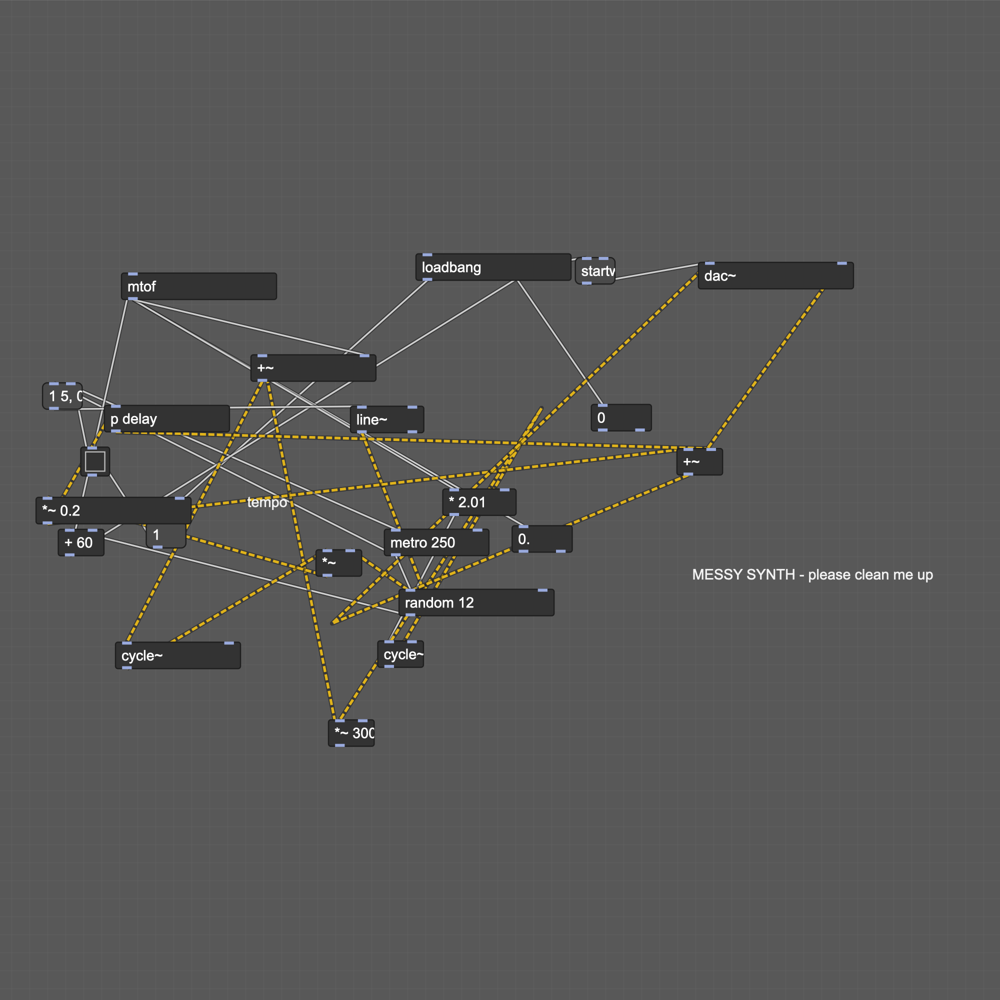
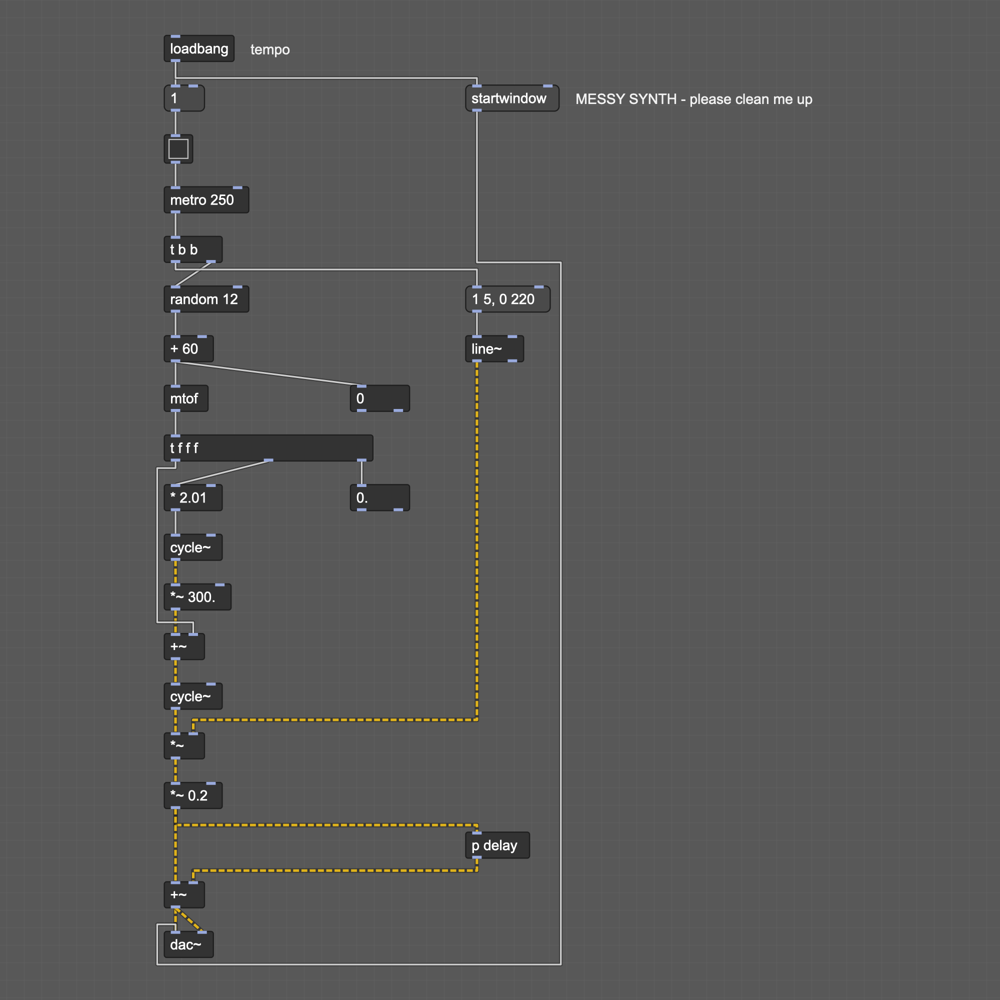

# maxformat

An agent skill and the generator it uses, for Max/MSP patches that are clean and
readable. Modules are titled columns, signal flows top to bottom, spacing is
generous, cords run at right angles, and every patch gets a presentation view.

- **The skill:** [`max-patch-layout/SKILL.md`](max-patch-layout/SKILL.md) describes
  the house style and selects detailed references by task.
- **The generator:** `maxformat.py` applies that style precisely, building a new
  patch from a spec or cleaning up an existing one.

```
./maxformat.py input.maxpat output.maxpat [options]
```

Python 3.9+ with no runtime dependencies. PNG previews need macOS. Use a fresh
output path for each candidate. Existing paths can be overwritten.

## Files

| File | What it does |
|---|---|
| `maxformat.py` | The command: formats a patch, scores it, or builds one from a spec. |
| `maxlayout/cli.py` | Parses options and runs the format / check / build steps. |
| `maxlayout/build.py` | Builds a house-style patch from a short JSON spec. |
| `maxlayout/layout.py` | Places boxes so sources sit above everything they feed. |
| `maxlayout/route.py` | Redraws every cord as right-angle segments that avoid boxes and each other. |
| `maxlayout/present.py` | Lays out the presentation view in titled sections. |
| `maxlayout/lint.py` | Scores tidiness and proves formatting didn't change the patch's behaviour. |
| `maxlayout/style.py` | Optional colour themes, used only when asked for. |
| `maxlayout/render.py` | Draws a patch to a PNG so it can be checked without opening Max. |
| `maxlayout/maxpat.py` | Reads and writes `.maxpat` files and knows Max's port geometry. |
| `maxlayout/mine_objdb.py` | Rebuilds the object port database from a local Max install. |
| `maxlayout/mine_refdb.py` | Rebuilds what each object does and what its inlets/outlets carry, from Max's reference. |

## Examples

Score the intentionally messy example without changing anything:

```sh
./maxformat.py examples/messy-synth.maxpat --check
```

Lay it out (sources on top, everything they feed below them), with a preview image:

```sh
./maxformat.py examples/messy-synth.maxpat examples/messy-synth.clean.maxpat --png
```

The static previews below show the intentionally messy source and its formatted
output. They are source-derived renders from `maxlayout.render`, not screenshots
from Max or Live. The formatted patch keeps execution order explicit with two
`[t]` objects.

**Before:** the source patch scores 0.0.



**After:** the formatted patch scores 89.2 and adds two `[t]` objects to
retain execution order.



Keep its existing arrangement, just tidier:

```sh
./maxformat.py examples/messy-synth.maxpat examples/messy-synth.clean.maxpat --keep-layout
```

Open an ordinary Max patch in a licensed Max session or edit a Max for Live
device from Live as appropriate:

```sh
open examples/messy-synth.clean.maxpat
```

Build a new patch from a spec:

```sh
./maxformat.py examples/fm-voice.spec.json /tmp/fm-voice.candidate.maxpat --png
```

Only redraw cords, without moving any boxes:

```sh
./maxformat.py examples/messy-synth.maxpat examples/messy-synth.clean.maxpat --route-only
```

Look up what a Max object does and what each inlet/outlet carries:

```sh
./maxformat.py --object cycle~
```

Run the tests:

```sh
python3 -m unittest discover -s tests -t .
```

## Safety

`maxformat.py` never writes a file if any connection, fan-out firing order, or
subpatcher inlet/outlet order would change. Max fires one outlet's cords right to
left by position, so moving boxes can silently change what a patch does.
When that would happen, it adds a `[t]` object to keep the order explicit
(or, with `--no-triggers`, refuses to write anything).

## Using the skill

The [deployment manifest](deployment.json) lists the offline tool and skill files
for a versioned local installation with DevTools. Link the installed
`max-patch-layout/` into the agent’s skills directory and expose the installed
`maxformat.py` through the local `maxformat` command. Use the same installed
revision for the command and skill.
